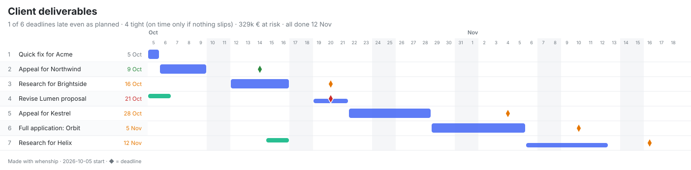

# whenship

**When will it ship, honestly?** A tiny planner for small teams. List the work, who does it and roughly how long it takes; whenship draws the timeline, tells you which deadlines will slip and why, and lets you drag things around until the plan works. It runs in the browser, offline, and inside Claude.



- **Real dates, not guesses.** A day-by-day scheduler handles priorities, part-time people, teams, hand-offs, dependencies, waiting on clients, weekends, holidays and time off.
- **Live what-if.** Drag to reprioritise and watch every date move before you drop. Change effort, people or working days and the whole plan updates instantly.
- **Honest risk.** Every deadline gets a badge (safe, likely, tight, late) and a rough chance, from a forecast scale that never touches your own numbers.
- **Options, not just warnings.** whenship searches reorders, deferrals, more time and extra people, and shows exactly which deadlines each one saves.
- **No sign-up, nothing stored.** Your plan lives in your browser, your files, or a link that carries the whole plan.

## Use it

| Where | How |
|---|---|
| **Your computer** | `npx whenship` opens it in your browser. Nothing leaves your machine. |
| **Offline file** | Download `whenship.html` (from any running whenship, at `/whenship.html`) and double-click it. |
| **Claude** | Add the connector (below) and ask: *"Sara has these five client deliverables… will she make the deadlines?"* |
| **Your own server** | One small Node service, no database, no Docker. See [Self-host](#self-host). |

Bring your plan in any shape: paste a list (`Grant draft for Acme, 5d, due 7 Oct`), spreadsheet rows, CSV, a Markdown table, or a saved plan file. Export it as a plan file (YAML), Excel with a Gantt sheet, PNG or SVG, a calendar (`.ics`), CSV, Markdown or JSON, or copy a link with the whole plan inside it.

## Use it in Claude

whenship is an [MCP App](https://modelcontextprotocol.io/extensions/apps/overview): Claude calls its engine for the dates and shows the interactive chart right in the conversation. Edit the chart and Claude sees your changes automatically, with no "send" button.

**Connector (claude.ai, Claude Desktop, mobile).** Settings → Connectors → Add custom connector, and enter your whenship address followed by `/mcp`, for example `https://your-whenship.example/mcp`. A public hosted address is coming; until then, use your own (see [Self-host](#self-host)) or the local options below.

**Claude Code**

```bash
claude mcp add whenship -- npx -y whenship --stdio
```

**Claude Desktop, Cursor, VS Code and other MCP clients (local)**

```json
{ "mcpServers": { "whenship": { "command": "npx", "args": ["-y", "whenship", "--stdio"] } } }
```

**Skills plugin (recommended with the connector).** It teaches Claude to always use the engine instead of estimating dates itself, and how to turn the results into advice:

```bash
claude plugin marketplace add HamedShams/whenship
```

```bash
claude plugin install whenship@whenship
```

The skills are plain Markdown: [plugin/skills/whenship](plugin/skills/whenship/SKILL.md) (workflow and plan format) and [plugin/skills/whenship-insights](plugin/skills/whenship-insights/SKILL.md) (recommendations, with worked examples for consultancies, product squads, solo founders, agencies, teams with a Saturday–Wednesday week, and teams working with AI agents).

Tools: `show_plan` (schedule and chart), `what_if` (compare changes), `find_options` (changes that meet more deadlines), `export_plan` (YAML, JSON, CSV, iCalendar, Markdown, link). All are read-only.

## How the forecast works

By default you see **your own estimates** (*As planned*). whenship never stretches them. The lens switch shows the same plan if work runs long the way it usually does:

| Lens | Multiplier | Meaning |
|---|---|---|
| As planned | 1× | Exactly what you entered: if everything goes to plan. |
| Likely | 1.6× | How it usually goes: about half of projects are done by here. |
| Safe bet | 2.7× | A date you can promise: about 85 in 100 projects are done by here. |
| Worst case | 3.9× | When things go badly: only 1 in 20 projects run longer. |

The badges use the same scale: *safe* means on time even at 2.7×, *likely* means on time at 1.6×, *tight* means on time only if nothing slips, and *late* means late even as planned.

The multipliers (P50 1.6×, P80 2.5×, P85 2.7×, P90 3.1×, P95 3.9×) are a blended outside-view heuristic: Todd Little's 2006 lognormal model of software estimation error, combined with Flyvbjerg et al.'s 2022 power-law findings on IT project overruns, with the midpoint sanity-checked by simple/geometric averaging and a 50/50 Monte Carlo mixture. They are practical, generic rules of thumb, not a formal industry standard. Your own track record beats them.

## The plan file

Plans are small, readable YAML files (`*.whenship.yaml`) you can keep in a repo, edit by hand, or drop into Claude:

```yaml
title: Client deliverables
start: 2026-10-05
lanes:
  - name: Sara
  - name: Omar
    availability: 50          # half his time
items:                        # in priority order
  - name: Appeal for Northwind
    who: Sara
    days: 4
    deadline: 2026-10-14
  - name: Revise Lumen proposal
    work:
      - { lane: Omar, days: 1 }
      - { lane: Sara, days: 3, after: Omar }   # hand-off
    deadline: 2026-10-20
```

Teams (`size: 3`), people per item (`maxPeople: 2`), `dependsOn`, `notBefore`, `value`, `calendar.workdays`, `calendar.holidays` and per-person `daysOff` are all supported. The full format is in the [whenship skill](plugin/skills/whenship/SKILL.md#plan-format).

## Self-host

whenship is one stateless Node service: the web app at `/`, the MCP connector at `/mcp`, a health check at `/healthz` and a privacy page at `/privacy`. No database, no accounts, no Docker.

On Railway (or Render, Fly, any Node host):

1. Create a service from this repository.
2. Build command `npm ci && npm run build`, start command `npm start`.
3. Set `PUBLIC_URL` to your address (e.g. `https://whenship.example.com/`); it is used in share links.
4. Health check path: `/healthz`.

The service listens on `$PORT`. Anywhere else: `npx whenship --host 0.0.0.0 --port 8080 --public-url https://… --no-open`.

## Privacy

whenship stores nothing about you or your plans on any server. The website keeps your plan in your browser. Share links carry the plan after the `#`, which browsers never send to a server. The connector schedules a plan in memory and returns it; it is not logged or kept. See [docs/PRIVACY.md](docs/PRIVACY.md).

## Develop

```bash
npm install
```

```bash
npm run dev
```

`npm run build` builds the single-file app (`dist/app.html`) and the CLI (`dist/cli.js`). `npm run check` runs the type check, all unit, regression and connector tests, and the scheduler tests in three time zones.

The code is small on purpose: `src/engine` (scheduler, forecast lens, insights; no dependencies), `src/io` (YAML, tables, links, Excel, calendar, SVG), `src/ui` (Preact app shared by the website and the Claude widget), `src/mcp` (connector and web server) and `src/cli`.

## Background

whenship grew out of [gantt_resource_planner](https://github.com/HamedShams/gantt_resource_planner), a capacity planner I built for two product squads, rewritten from scratch for small teams of every kind.

## License

[MIT](LICENSE)
