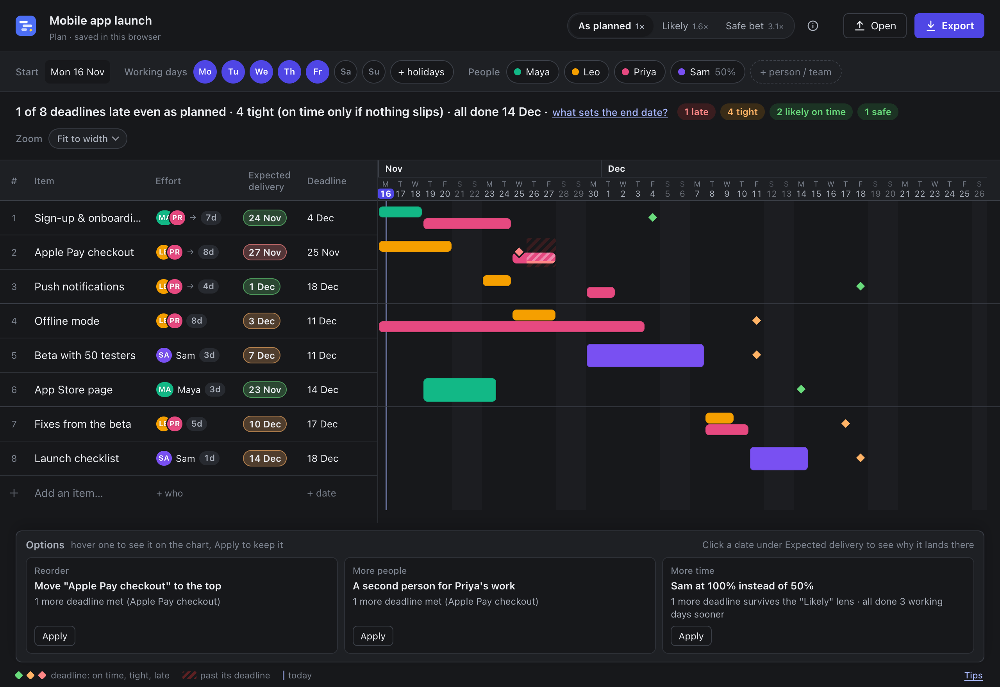

# whenship

**When will it ship, honestly?** A tiny planner for small teams. List the work, who does it and roughly how long it takes; whenship draws the timeline, tells you which deadlines will slip and why, and lets you drag things around until the plan works. It runs in the browser, offline, and inside Claude. It's open source: use the hosted copy at [whenship.app](https://whenship.app), or run your own with one command, as an offline file or on your own server. Every copy works the same.



*The plan in the picture is [docs/example.whenship.json](docs/example.whenship.json): four people, eight items, a launch date. One promise is two days late, and the first option under the chart fixes it for free.*

- **Real dates, not guesses.** A day-by-day scheduler handles priorities, part-time people, teams, hand-offs, dependencies, waiting on clients, weekends and holidays.
- **Live what-if.** Drag an item up or down to reprioritise, drag a bar's edge to change its effort, drag a deadline: every date moves before you let go. ⌘/Ctrl Z undoes.
- **Honest risk.** Every deadline gets a badge (safe, likely, tight, late) and a rough chance, from a forecast scale that never touches your own numbers.
- **Options, not just warnings.** whenship searches reorders, deferrals, more time and extra people, and shows exactly which deadlines each one saves. Hover an option to see it on the chart before you apply it.
- **No sign-up, nothing stored.** Your plan lives in your browser, your files, or a link that carries the whole plan.

## Use it

| Where | How |
|---|---|
| **Web** | Open [whenship.app](https://whenship.app), the hosted copy: pick an example, paste your list, open a file or start from scratch. Your plan stays in your browser, and the next visit opens straight on it (the logo goes back to the home page). |
| **Your computer** | `npx whenship` opens it in your browser. Nothing leaves your machine. |
| **Offline file** | Download `whenship.html` (from any running whenship, at `/whenship.html`) and double-click it. |
| **Claude** | Add the connector or the desktop extension ([two ways](#use-it-in-claude)) and ask: *"Sara has these five client deliverables… will she make the deadlines?"* |
| **Your own server** | One small Node service, no database, no Docker. See [Self-host](#self-host). |

`npx whenship` runs the [npm package](https://www.npmjs.com/package/whenship). From a clone it is the same thing: `npm ci && npm run build`, then `node dist/cli.js` (add `--stdio` for the MCP server).

**Bring your plan in any shape:** paste a list (`Grant draft for Acme, 5d, due 7 Oct`), spreadsheet rows, CSV, a Markdown table, or open a saved plan file.

**Take it out again:** a plan file (JSON), Excel with a Gantt sheet, CSV, a PNG of the chart, a Markdown summary, or a link with the whole plan inside it. Links keep the view too (the forecast lens and the zoom), and the website remembers both between visits.

## Use it in Claude

whenship is an [MCP App](https://modelcontextprotocol.io/extensions/apps/overview): Claude calls its engine for the dates and shows the interactive chart right in the conversation. Edit the chart and Claude sees your changes automatically, with no "send" button. Then ask something like: *"Sara has these five client deliverables… will she make the deadlines?"*

There are two ways to add it. Both show the same chart.

### Option 1: the connector (online, nothing to install)

Works in claude.ai, Claude Desktop and the mobile apps.

1. In Claude, open **Settings → Connectors**.
2. Choose **Add custom connector**.
3. Name it `whenship` and enter the address `https://whenship.app/mcp` (or your own server's address followed by `/mcp`, see [Self-host](#self-host)).
4. Save. In a chat, make sure whenship is switched on in the tools menu, then ask your question.

On a Team or Enterprise plan, an owner adds it once for everyone under **Organization settings → Connectors**.

### Option 2: the Claude Desktop extension (a file, runs on your computer)

Nothing leaves your machine: the engine runs locally with Claude Desktop's built-in Node.

1. Download `whenship.mcpb` from the [latest release](https://github.com/HamedShams/whenship/releases/latest).
2. In Claude Desktop, open **Settings → Extensions**.
3. Choose **Install extension** and pick the file (double-clicking the file also works).
4. Confirm the install, then ask your question in a new chat.

To update, install the newer file over the old one. To build the file yourself: `npm run build && npm run build:mcpb` (set `WHENSHIP_PUBLIC_URL` to choose where "Open in browser" and share links go).

### Other clients

**Claude Code**

```bash
claude mcp add whenship -- npx -y whenship --stdio
```

Or the hosted connector, with nothing to install:

```bash
claude mcp add --transport http whenship https://whenship.app/mcp
```

**Cursor, VS Code and other MCP clients (local)**

```json
{ "mcpServers": { "whenship": { "command": "npx", "args": ["-y", "whenship", "--stdio"] } } }
```

### Skills plugin (recommended with either option)

It teaches Claude to always use the engine instead of estimating dates itself, and how to turn the results into advice:

```bash
claude plugin marketplace add HamedShams/whenship
```

```bash
claude plugin install whenship@whenship
```

The skills are plain Markdown: [plugin/skills/whenship](plugin/skills/whenship/SKILL.md) (workflow and plan format) and [plugin/skills/whenship-insights](plugin/skills/whenship-insights/SKILL.md) (recommendations, with worked examples for consultancies, product squads, solo founders, agencies, teams with a Sunday–Thursday week, and teams working with AI agents). The plugin holds skills only; the chart comes from the connector or the extension.

### What Claude gets

Tools: `show_plan` (schedule and chart), `what_if` (compare a list of changes, or a whole alternative version of the plan), `find_options` (changes that meet more deadlines), `export_plan` (JSON, CSV, iCalendar, Markdown, link). All are read-only.

In the chart, **Ask Claude for better options** (a button above the options) posts a request to the chat. Claude tries what the built-in suggestions can't (moving work between people, splitting or cutting items, combinations), checks each idea with `what_if`, and sends its best one or two back through `show_plan`: they appear in the chart as options with their exact effects, in place of the lowest-ranked built-in ones, so the chart never shows more than three. An option of Claude's that you apply leaves the list (undo brings it back), and one that brings in someone who is already in the plan uses that person instead of adding a second one. Claude's reply stays short, and nothing leaves the chart: it exports itself.

## How the forecast works

By default you see **your own estimates** (*As planned*). whenship never stretches them. The lens switch shows the same plan if work runs long the way it usually does:

| Lens | Multiplier | Meaning |
|---|---|---|
| As planned | 1× | Exactly what you entered: if everything goes to plan. |
| Likely | 1.6× | How it usually goes: about half of projects are done by here. |
| Safe bet | 3.1× | A date you can promise: about 9 in 10 projects are done by here. |

The badges use the same scale: *safe* means on time even at 3.1×, *likely* means on time at 1.6×, *tight* means on time only if nothing slips, and *late* means late even as planned. With another lens on, every deadline that lens's dates miss shows as *late*.

**Where the numbers come from.** People underestimate, so the lenses show the plan when work runs long the way it usually does. The multipliers (P50 1.6×: about half of projects are done by then; P90 3.1×: about 9 in 10) come from a blended outside-view heuristic: Todd Little's 2006 lognormal model of software estimation error, combined with Flyvbjerg et al.'s 2022 power-law findings on IT project overruns, sanity-checked by simple/geometric averaging and a 50/50 Monte Carlo mixture. They are practical, generic rules of thumb, not a formal industry standard. Your own track record beats them.

**The "~x% chance"** on each deadline reads the same scale: a smooth (lognormal) curve through those two points (P80 ≈ 2.5×, P95 ≈ 3.7×; about 1 plan in 5 finishes as estimated). It assumes the whole plan runs long or short together, so it is a rough guide for one deadline, not a combined probability for several.

The chart's lens guide (the ⓘ next to the lenses) carries a two-sentence version of this; this section is the full one.

## Reading the chart

The list on the left has one row per item, in priority order: `# · Item · Effort · Expected delivery · Deadline`. The expected delivery is what whenship works out from the effort, so it sits right beside it; the deadline is what you set, and comes last as the yardstick.

| Mark | Meaning |
|---|---|
| Bar | When someone works on the item, one colour per person or team. An item with several people has one thin bar each. |
| ◆ Diamond | The item's deadline (the usual Gantt milestone mark). Green: on time. Amber: tight. Red: late. |
| Hatched stripes | The part of the work that runs past the deadline. |
| Vertical line | Today. |
| Thin grey line under a bar | Only with *Likely* or *Safe bet* on: your own estimate (the *As planned* dates), while the bar shows the stretched ones. Gantt tools call this the baseline. |
| "ends 9 Dec" beside a bar | The finish date, shown for the row under the pointer, the selected row, and any row whose date is changing. |

A small key under the chart repeats this, and hovering any mark gives its dates. A line under every third row runs across the list and the chart, so a row can be followed to its bar.

## Working in the chart

| To | Do this |
|---|---|
| Add an item | Type in the empty row at the bottom. Its settings open as you name it; Enter closes them and moves down a row. |
| Reprioritise | Drag a row by its ⠿ handle, or drag its bar up or down. Every date updates before you drop, and the page scrolls with you on a long list. |
| Change the effort | With one person in the plan, type the days into the row. With several people or a team, click the Effort cell: who does how many days, and who starts after whom. Or drag a bar's right edge. |
| Set or move a deadline | Click the Deadline cell: a small calendar opens under the row (you can also type a date, "7 Dec"). Or drag the ◆ on the chart. |
| See why a date is what it is | Click the date under Expected delivery: a short note lists the reasons in plain words (who it waits for, what it starts after, how far it is from its deadline). |
| Open an item's settings | Click its name: *can't start before*, *starts after*, a note (up to 120 characters), and **Mark as done** (a finished item takes no more time, and whatever waited for it can start). Names and notes are only words: editing them never re-plans anything. |
| Try an option | The dock under the chart holds up to three options, each an exact re-plan. Hover one to see it on the chart as dashed bars, Apply to keep it, ⌘/Ctrl Z to take it back. |
| Change the scale | The chart fits the whole plan to the width it has. The Zoom menu offers fixed day, week and month scales. |
| See what sets the end date | Click *what sets the end date?* next to the headline: the chain of work behind the last finish lights up. |

What a row opens (its settings, who works on it, why its date, the deadline calendar) is docked right under that row and stays there: it scrolls with the page and lies over the options dock, which never moves. One is open at a time, and it closes by itself when its row scrolls out of sight behind the dock.

Undo is ⌘/Ctrl Z, redo ⇧⌘Z (Ctrl Y). Export gives the plan file, Excel, CSV, an image of the chart (with the same columns and key) and a Markdown summary.

If dragging ever misbehaves in your browser, add `#debug` to the address. Every row then carries a small tag at the place the page has measured it to be, and each drag is written down (until two seconds after the drop). Drag once, take a screenshot if rows and tags don't line up, press **Copy drag log** in the corner, and put both into [an issue](https://github.com/HamedShams/whenship/issues). The record holds which browser it is, what it sent and where the page drew the row, and nothing about your plan beyond the rows' names.

## How the dates and suggestions work

**The scheduler.** whenship walks the calendar one working day at a time. Each day, items get people in priority order, up to what each item can use: a person's share of time (`availability`), a team's size, how many people may work on one item (`maxPeople`) and the work left. It respects hand-offs, dependencies, can't-start-before dates, working days and holidays. An item's prerequisites are worked on at its priority, so a top item never waits behind unrelated work for something it needs. The same plan always gives the same dates. Tests check it against an independent reference scheduler on 400 random plans.

**The suggestions** are not AI. They come from a fixed try-and-measure loop:

1. Build a short menu of single changes (below).
2. Re-plan the whole schedule for each one with the same engine.
3. Keep only the changes that meet more deadlines or make the plan sturdier (more deadlines survive the next lens, fewer days late, or a clearly earlier finish).
4. Rank them: most deadlines met, then the cheapest kind of move, then most deadlines that survive the next lens, then fewest days late, then earliest finish. Show the top 3, at most 2 of a kind.

| Kind | What it tries | Cost rank |
|---|---|---|
| Reorder | The smallest move up that saves a late item (found by binary search) | Free |
| Defer | Undated work that sits in front of late deadlines moves behind the dated work | Free |
| More time | A part-timer goes to 100% | Low |
| More people | One more person in that lane | High |
| Negotiate | The exact extra working days a late item needs | Last resort |

It doesn't try every possibility (10 items already have 3.6 million possible orders). It takes a few milliseconds on normal plans and is switched off above 200 items.

**How far to trust it.**

- The numbers are exact. Every effect shown comes from a real re-plan, so it can't invent one.
- The coverage is narrow:
  - one change at a time, so it never finds combinations ("reorder *and* one extra day");
  - a fixed menu: it never moves work from one person to another, splits or cuts scope, puts a second person on an item, drops a dependency or adds overtime;
  - "one more person" is productive from day one and costs nothing, which is optimistic;
  - it counts deadlines but doesn't know which ones are hard, or which client matters most;
  - its ordering is good, not provably the best.

**The Claude layer covers the gaps.** In Claude, `find_options` returns the same menu. For anything else, Claude writes the changed plan and checks it with `what_if` before it recommends anything, so every number it quotes still comes from the engine. *Ask Claude for better options* in the chart starts exactly that.

## The plan file

Plans are small JSON files (`*.whenship.json`) you can keep in a repo, edit by hand, or drop into Claude:

```json
{
  "title": "Client deliverables",
  "start": "2026-10-05",
  "lanes": [
    { "name": "Sara" },
    { "name": "Martin", "availability": 50 }
  ],
  "items": [
    { "name": "Appeal for Northwind", "who": "Sara", "days": 4, "deadline": "2026-10-14" },
    { "name": "Revise Lumen proposal", "work": [{ "lane": "Martin", "days": 1 }, { "lane": "Sara", "days": 3, "after": "Martin" }], "deadline": "2026-10-20" }
  ]
}
```

Items are in priority order (an item's prerequisites in `dependsOn` are worked on at its priority). `availability` is the share of someone's time for this plan, and `after` is a hand-off (Sara starts when Martin is done). Teams (`"size": 3`), people per item (`"maxPeople": 2`), `dependsOn`, `notBefore`, `calendar.workdays` and `calendar.holidays` are also supported; the full format is in the [whenship skill](plugin/skills/whenship/SKILL.md#plan-format).

### Limits, and why

whenship is for a plan you can see at once, so it has two deliberate ceilings. Anything over them is read, trimmed, and said so (in the chart, and in Claude's answer).

| Limit | Why |
|---|---|
| **40 items in a plan** | About two screens. A chart is the answer to "when will it ship?" only while you can take it in; past that it is a database with bars. Bigger work is several plans: one per team, release or quarter, each saved as a file or a link. |
| **250 working days for one part of an item** | A person-year. Nobody estimates a single task at more than that; beyond it the number is a placeholder, and the chart would be a wall. Longer work is several items, which also gives the chart something to say about the order. |

Smaller ones you will not meet: 50 people or teams, 20 parts per item.

**Share links** carry the whole plan after the `#` in the address (`…/#p=…`), not in a `?query`. Browsers never send the part after `#` to a server, so a shared plan still never reaches whenship.app or anyone's logs; it unpacks in the reader's browser. The lens and zoom travel with it (`&l=`, `&z=`).

## Self-host

whenship is one stateless Node service: the web app at `/`, the MCP connector at `/mcp` (opened in a browser, it explains how to add it to Claude), a health check at `/healthz` and a privacy page at `/privacy`. For search engines and AI assistants it also serves `/robots.txt`, `/sitemap.xml`, `/llms.txt`, a link-preview image and an icon, all pointing at the server's own address. No database, no accounts, no Docker.

On Railway: create a service from this repository. `railway.json` sets the build, start command and health check. Optionally set `PUBLIC_URL` to your address (e.g. `https://whenship.example.com/`) for share links; otherwise the address requests come in on is used.

On Render, Fly or any other Node host: build with `npm ci && npm run build`, start with `npm start`, health check `/healthz`.

The service listens on `$PORT`. Anywhere else: `npx whenship --host 0.0.0.0 --port 8080 --public-url https://… --no-open`.

## Privacy

whenship stores nothing about you or your plans on any server. The website keeps your plan in your browser. Share links carry the plan after the `#`, which browsers never send to a server. The connector schedules a plan in memory and returns it; it is not logged or kept. See [docs/PRIVACY.md](docs/PRIVACY.md).

## Develop

```bash
npm install
```

```bash
npm run dev
```

`npm run build` builds the single-file app (`dist/app.html`) and the CLI (`dist/cli.js`); `npm run build:mcpb` packs the Claude Desktop extension; `npm run docs:pictures` retakes the README screenshot and the link-preview image with headless Chrome. `npm run check` runs the type check, all unit, regression, UI, widget and connector tests with a coverage floor, and the scheduler tests in three time zones. The tests also run the built CLI (web, connector over HTTP and stdio), check what the npm package ships and the website's search tags. CI also audits dependencies and runs the built CLI on Node 20. Pushing a version tag (`vX.Y.Z`) publishes a GitHub Release with the extension attached. `server.json` is the entry for the [MCP Registry](https://registry.modelcontextprotocol.io).

The code is small on purpose: `src/engine` (scheduler, forecast lens, insights; no dependencies), `src/io` (plan files, tables, links, Excel, calendar, images), `src/ui` (Preact app shared by the website and the Claude widget), `src/mcp` (connector and web server) and `src/cli`.

## Background

whenship is made by [Hamed Shams](https://hamedshams.com). It grew out of [gantt_resource_planner](https://github.com/HamedShams/gantt_resource_planner), a capacity planner I built for two product squads, rewritten from scratch for small teams of every kind.

## License

[BSD 3-Clause](LICENSE), © Seyed Hamed Shams. Use it, change it, host it and build on it, including commercially. Copies keep the copyright notice and the license text, and the author's name may not be used to promote a changed version. Running your own copy of whenship is welcome; if you publish a changed version, please give it its own name so people can tell it apart from the original at [whenship.app](https://whenship.app).
